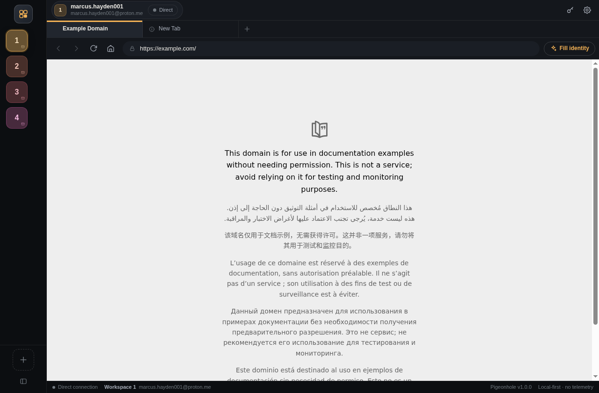
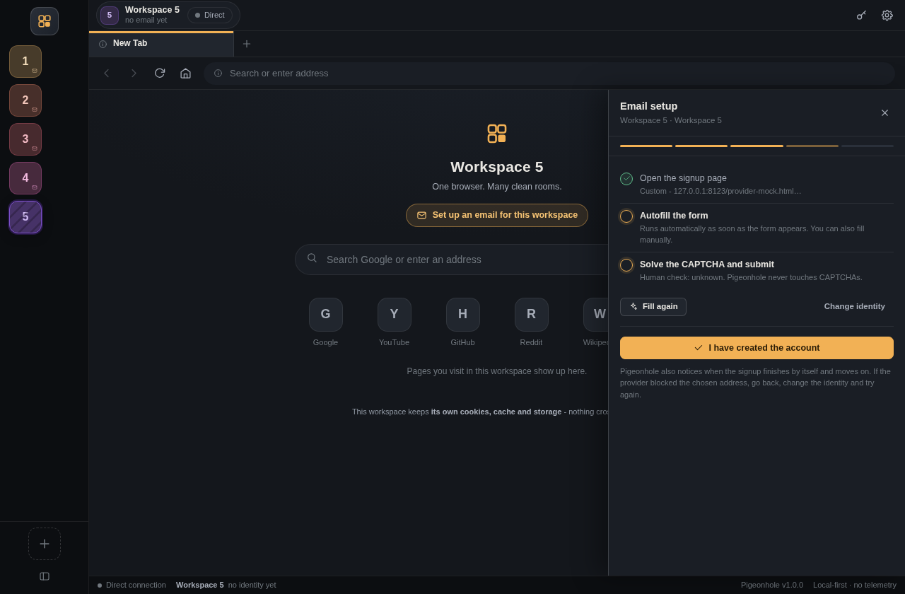
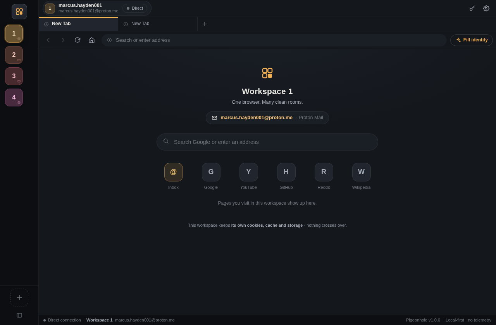
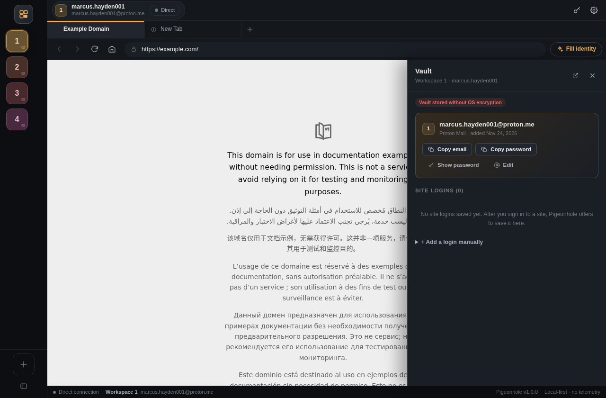

# Pigeonhole

# [Download the latest release](https://github.com/diiiamondmaster/pigeonhole/releases)

Grab **`Pigeonhole-vX.X.X-win-x64.zip`** from the Releases page - just the
runnable files, no git and no install needed. Extract it anywhere and
double-click **`Pigeonhole.exe`**.

---

One browser. Many clean rooms.

Pigeonhole is a lightweight desktop browser for Windows built around one idea:
**every account gets its own workspace**, and every workspace is a fully
separated browser profile. If you use several accounts on the same site - for
testing, for separating parts of your life, or for keeping each account away
from the others - each one lives in its own numbered tile, in its own clean
room, under one roof.

It is built on Electron, so pages render exactly as they do in Chrome. What it
adds on top:

- **Isolated workspaces.** Each workspace has its own cookies, cache,
  localStorage, IndexedDB and service workers. Nothing crosses over - you can
  be signed in to the same site in five workspaces at the same time.
- **Guided email setup.** Creating the Nth mailbox is a wizard: pick a provider
  that does not demand a phone number, generate a numbered address
  (`yourhandle001`, `yourhandle002`, ...), and let Pigeonhole fill the signup
  form. You solve the CAPTCHA and press Create - the account is born inside
  the very workspace it will live in.
- **One identity per workspace.** After setup, Pigeonhole detects login and
  signup forms and offers to fill them with the workspace's email and
  password. Site logins can be saved to a per-workspace vault, encrypted with
  the operating system's credential store when available.
- **Local-first.** No account, no telemetry, no analytics. All state lives on
  your machine. See [docs/privacy-security.md](docs/privacy-security.md).

| Browsing with several workspaces | The email setup wizard |
| --- | --- |
|  |  |

| Per-workspace new tab page | The vault |
| --- | --- |
|  |  |

## Quick start

1. **Download** `Pigeonhole-vX.X.X-win-x64.zip` from the
   [Releases page](https://github.com/diiiamondmaster/pigeonhole/releases)
   (the big link at the top of this README goes there too) - just the runnable
   files, no git needed. Prefer the whole codebase instead? Green `<> Code`
   -> `Download ZIP`.
2. Extract the ZIP anywhere (right-click -> Extract All).
3. Double-click **`Pigeonhole.exe`**. Windows SmartScreen may ask on first
   launch - choose *More info* -> *Run anyway* (the build is unsigned).
4. Click the **+** tile in the sidebar. The email wizard opens and walks you
   through the first workspace.
5. Switch workspaces by clicking their tiles (`Alt+1`, `Alt+2`, ...), and
   hide the whole sidebar with `Ctrl+B` when you want the space.

That is it. There is no installer, no registration and no cloud service.

## What the wizard does

1. **Choose a provider.** The wizard shows a comparison table every time -
   providers that currently do not require a phone number come first
   (Proton Mail, Tuta, Mailfence). Facts drift, so the table is honest about
   what each provider asks for; full notes live in
   [docs/email-providers.md](docs/email-providers.md).
2. **Generate an identity.** By default a numbered address:
   your base handle plus an auto-incrementing number with adjustable
   zero-padding (`fox001@proton.me`, `fox002@proton.me`, ...). Human-name and
   word-pair styles are one click away. The password can be generated, typed,
   or taken from an optional shared password you configure once in Settings.
3. **Create the account.** The signup page opens inside the workspace and
   Pigeonhole fills it - username, name, date of birth, gender, password,
   confirm, security answer, terms box. CAPTCHAs are never touched; that part
   stays yours. When the signup completes, the wizard notices (or you click
   one button) and the identity is saved to the workspace vault.

## How workspaces stay separate

Each workspace is a separate Chromium **partition** - an isolated browser
profile directory with its own cookie jar, cache and storage. Deleting a
workspace wipes its profile from disk. The technical walk-through (sessions,
the internal `pigeonhole://` pages, the IPC surface, the security model) is in
[docs/how-it-works.md](docs/how-it-works.md).

## Keyboard shortcuts

| Keys | Action |
| --- | --- |
| `Ctrl+T` / `Ctrl+W` | New tab / close tab |
| `Ctrl+L` | Focus the address bar |
| `Ctrl+R` / `F5` | Reload |
| `Alt+Left` / `Alt+Right` | Back / forward |
| `Alt+Home` | New tab page |
| `Ctrl+F` | Find in page |
| `Alt+1` ... `Alt+9` | Switch to workspace 1-9 |
| `Ctrl+Tab` / `Ctrl+Shift+Tab` | Next / previous tab |
| `Ctrl+B` | Show or hide the workspace sidebar |
| `Ctrl+Shift+N` | New workspace |
| `Ctrl+=` / `Ctrl+-` / `Ctrl+0` | Zoom in / out / reset |
| `Ctrl+Shift+I` | Developer tools |

## Roadmap

- **v1.1 - per-workspace proxy routing.** Route each workspace through its
  own SOCKS5/HTTP proxy so accounts never share an IP address. The settings
  preview is already in the app (Workspace settings -> Network); the routing
  itself arrives with 1.1.
- Vault import, workspace-level history management, and light theme are also
  on the list - see [docs/roadmap.md](docs/roadmap.md).

## For developers

```bash
npm install        # electron + electron-builder (no runtime dependencies)
npm start          # run the app
npm test           # form-engine regression suite (21 assertions)
npm run shots      # capture every UI state to dev-shots/
npm run dist       # cross-build the Windows portable bundle
```

The chrome is dependency-free HTML/CSS/ES modules under `app/`; the main
process (state store, IPC, sessions, menus, downloads, internal protocol)
lives under `main/`. Start with [docs/how-it-works.md](docs/how-it-works.md).

## License

[MIT](LICENSE). Pigeonhole ships Chromium and Electron; their licenses are
included with every build (`LICENSES.chromium.html`).
